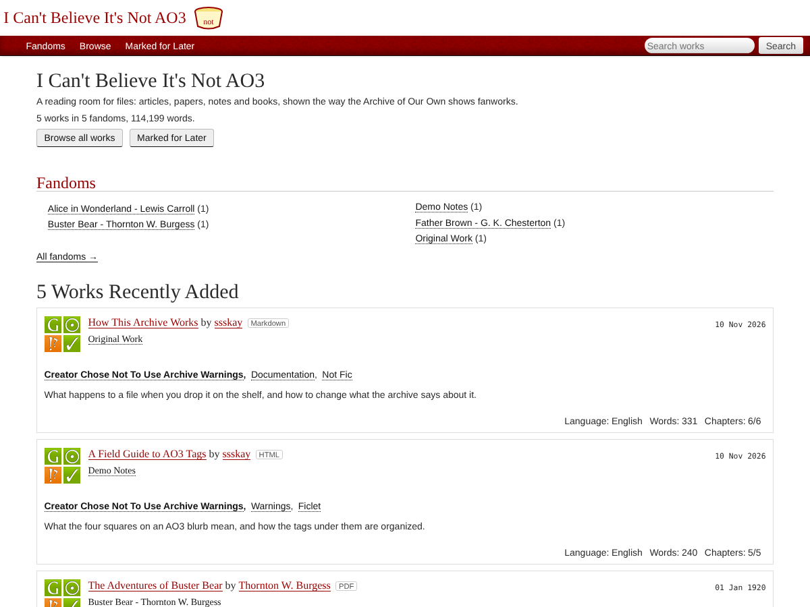
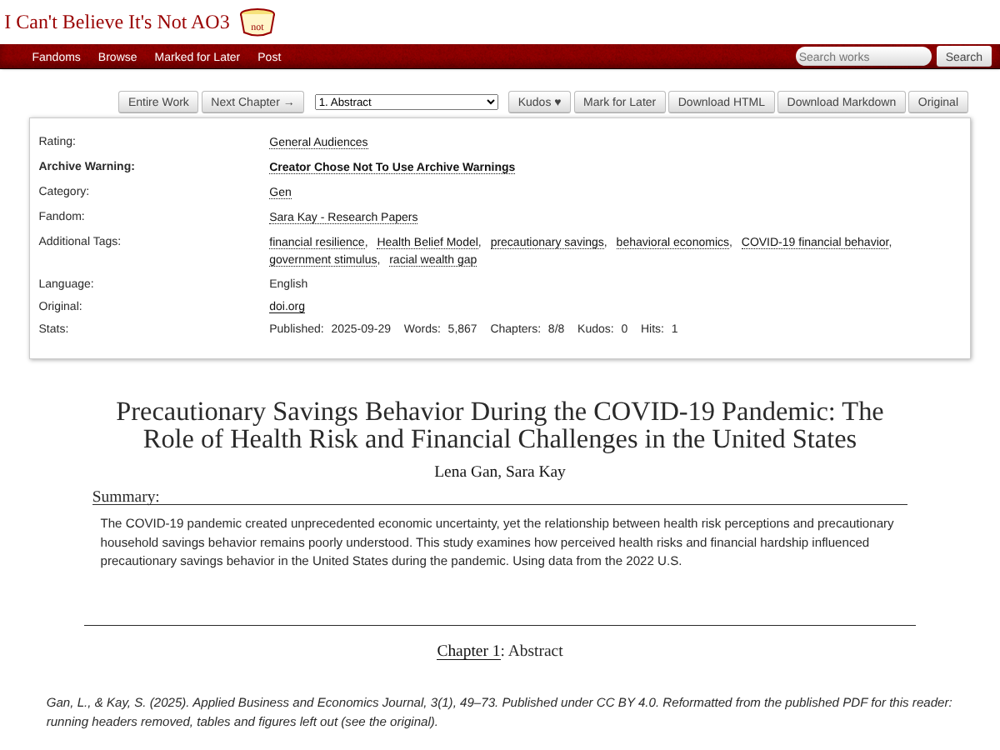

# I Can't Believe It's Not AO3

A reader that turns a folder of files into a website laid out like the [Archive of Our Own](https://archiveofourown.org): articles, papers, notes and books get blurbs, fandoms, tags, chapters, kudos and Mark for Later.



Drop files into a folder. Each file becomes a work, each top-level folder becomes a fandom, and the site fills in the rest: chapters from the file's headings or bookmarks, characters from names that keep coming up, and tags from the words that set the work apart.

## Why this exists

At the end of October 2026, AO3 went offline after a security incident, with [reports that it could be down for up to four weeks](https://techcrunch.com/2026/10/29/fan-fiction-site-archive-of-our-own-could-be-offline-for-up-to-4-weeks/). A lot of us found out that we missed the layout as much as the fic: the four squares, the tag list you skim before deciding, the word count, leaving kudos.

So this is for anyone with AO3 withdrawal. It puts everything else you read (articles, papers, PDFs, ebooks, your own notes) in the layout you miss. It doesn't connect to AO3 and doesn't contain anyone's fic. It only reads files you put in it.

**Demo:** [ssskay.github.io/not-ao3](https://ssskay.github.io/not-ao3/), built from the public-domain books, essays and sample pages in [`demo-shelf/`](demo-shelf).



## What it reads

| File | Chapters come from | Metadata it picks up |
|---|---|---|
| Markdown `.md` | `#` or `##` headings | front matter |
| Text `.txt` | lines like `CHAPTER I` or `IV. The Purple Wig` | front matter |
| Saved web page `.html` | `<h1>`/`<h2>` headings in the article | title, author, site name, date, description |
| EPUB `.epub` | one chapter per section | title, author, date, subjects, description |
| PDF `.pdf` | the PDF's bookmarks | title, author, subject, keywords |

Saved web pages keep the article and lose the site's menus, scripts, forms and footer.

## Use it

You need Python 3 and two packages:

```
pip3 install markdown pypdf
```

On a Mac, double-click **Open Archive.command**. It builds the site, opens it in your browser, and rebuilds whenever you add or change a file. It stops after 3 hours with no page loads.

From a terminal:

```
python3 notao3.py serve      # build, open in the browser, rebuild on changes
python3 notao3.py build      # just build into site/
python3 notao3.py selftest   # build the demo shelf and check every page
```

Your files go in `shelf/`. If `shelf/` is empty, the demo shelf is used. `shelf/` and `site/` are in `.gitignore`, so your own files never end up in the repo.

The built site is plain HTML with relative links. It works opened straight from the folder, on any static host, or in a subfolder.

## Cleaner imports

Web pages and PDFs are the messy formats, so each one is converted once into a Markdown **clean copy** in `shelf/.clean/`, and the site is built from that copy.

- **Edit a clean copy and your version wins.** Fix a line, delete leftover junk, rename a chapter (lines like `<!-- chapter: Methods -->` start chapters). Your edits are kept, even if the original file changes later. Delete the clean copy to make a fresh one.
- **Better converters, if you install them.** With `pip3 install trafilatura`, web pages go through [Trafilatura](https://github.com/adbar/trafilatura), which is good at cutting share buttons, newsletter boxes and related-article lists. The built-in reader is still used when Trafilatura drops text from a tidy page. PDFs without bookmarks go through [Docling](https://github.com/docling-project/docling) when it's available, which keeps tables as tables. Docling needs a Python with PyTorch: either `pip3 install docling`, or point `docling_python:` in `shelf/_archive.meta` (or the `NOTAO3_DOCLING_PYTHON` environment variable) at a Python that has it. Its first run downloads its models.
- **Import report.** Every build writes `report.html` (linked in the footer) and a copy in `audits/`, listing works that look off: chapters with almost no words, one giant chapter, leftover menu text, words split in two, running headers repeated on every page.

The demo's clean copies are committed, so the GitHub Pages build doesn't need Trafilatura or Docling.

## Changing what it says about a file

Put a `.meta` file next to it, named after the file plus `.meta` (`paper.pdf.meta`):

```
title: A Better Title
author: Someone, Someone Else
fandom: Research Papers
rating: Teen
tags: My Own Tag, Another Tag
extra_tags: Added To The Automatic Ones
characters: none
summary: One line about it.
published: 2024-05-01
url: https://example.com/where-it-came-from
complete: no
```

Every line is optional. Markdown and text files can put the same lines at the top between `---` lines. A `_folder.meta` file sets defaults for a whole folder, and `shelf/_archive.meta` sets `site_name`, `intro` and `noindex: yes` for the whole site.

Defaults: rating General Audiences, warning Creator Chose Not To Use Archive Warnings, category Gen, language English. Files directly in `shelf/` use the page's site name as their fandom, or Uncategorized Fandom.

## Kudos, Mark for Later, hits

These are saved in the visitor's own browser (localStorage). Nothing is sent anywhere, there are no accounts, and nobody sees anyone else's.

## Publishing the demo with GitHub Pages

`.github/workflows/pages.yml` runs the selftest, builds `demo-shelf/` and publishes it on every push to `main`. Turn it on once under **Settings → Pages → Source: GitHub Actions**.

## Logs and checks

Builds log to `logs/notao3.log`, one line per file with format, chapter count, words and time taken. `selftest` writes a dated report to `audits/`.

## See also

- [flamebyrd/makesite](https://github.com/flamebyrd/makesite) turns a folder of fic (AO3 downloads, HTML, Markdown) into an archive site with AO3-style metadata. If you want to host your own fic, start there.
- [ao3-style.css](https://fan.kingdra.net/ao3css/) styles fics you've downloaded from AO3 as HTML.

## Credits and license

- The look is AO3's own stylesheet, `public/stylesheets/site/2.0` from [otwcode/otwarchive](https://github.com/otwcode/otwarchive), with the images it uses. Copyright the Organization for Transformative Works, GPL-2.0-or-later. The AO3 logo is not included.
- This project is **not affiliated with the Organization for Transformative Works or the Archive of Our Own**. "Archive of Our Own" and "AO3" are theirs. The name here is a parody.
- The demo shelf is public domain apart from the pages written for it. Books and essays come from Project Gutenberg texts with the Gutenberg header and license removed (each work's Original link goes to its Gutenberg page): Lewis Carroll, G. K. Chesterton, Thornton W. Burgess, Jane Austen, William Blake, Sara Cone Bryant, Herman Melville, John Milton, William Shakespeare (First Folio spelling), Jonathan Swift, Henry David Thoreau, Thomas Paine, Ralph Waldo Emerson and Mark Twain. `data/common-words.txt` is a word list counted from the same kind of public-domain sample.
- The Bible is the [World English Bible](https://ebible.org/Scriptures/), which eBible.org dedicated to the public domain. The text is unchanged; only the layout is new (one chapter per book, verse numbers inline).
- *Precautionary Savings Behavior During the COVID-19 Pandemic* is by Lena Gan and Sara Kay, *Applied Business and Economics Journal* 3(1), 2025, [doi:10.61089/abej.2025.3.145](https://doi.org/10.61089/abej.2025.3.145), published under [CC BY 4.0](https://creativecommons.org/licenses/by/4.0/). It was reformatted from the PDF: running headers removed, and the tables and figures left out (each has a note pointing to the original).
- The Internet Historian case study is my own writing, saved from [sarakay.me](https://sarakay.me/case-studies/internet-historian). It isn't public domain and isn't covered by the GPL license below.
- Everything else here is licensed **GPL-2.0-or-later** (see [LICENSE](LICENSE)), matching the stylesheet it builds on.

---

Made by [Sara Kay](https://sarakay.me).
